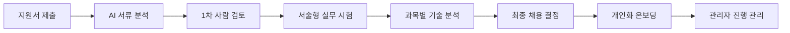
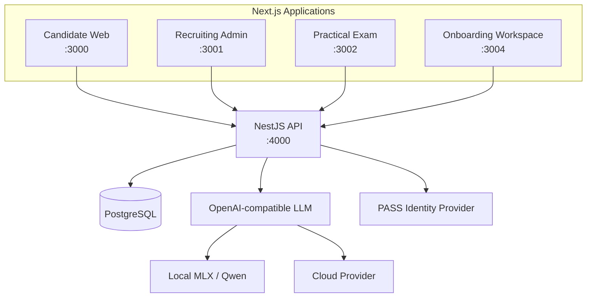

# Relay

> AI로 지원자의 서류와 기술 답변을 구조화하고, 채용 데이터를 개인화 온보딩까지 연결하는 풀스택 HR 플랫폼

`Next.js` · `NestJS` · `TypeORM` · `PostgreSQL` · `OpenAI-compatible LLM` · `RAG`

Relay는 산업용 Vision AI 기업 **Surplus(흑자)**의 채용 운영을 모델로 만든 MVP입니다. 지원서 접수, AI 서류 분석, 서술형 실무 시험과 AI 평가 보조, 최종 채용 판단, 신입사원 온보딩을 하나의 경험으로 설계했습니다.

이 프로젝트에서 집중한 질문은 하나였습니다.

> **채용 과정에서 발견한 지원자의 강점과 부족한 역량을, 입사 후 성장 데이터로 이어갈 수 있을까?**

## Problem

소규모 기술 기업의 채용과 온보딩에는 다음과 같은 병목이 있습니다.

- 지원자 정보를 노션이나 스프레드시트로 다시 옮겨 적어야 합니다.
- 관리자가 모든 이력서를 처음부터 끝까지 읽어야 합니다.
- 정답만 보는 시험으로는 지원자의 실제 사고 과정을 알기 어렵습니다.
- 채용 중 확인한 역량 정보가 입사 후 온보딩에 활용되지 않습니다.
- 전담 교육 담당자가 없어 사수에게 반복적인 설명 업무가 집중됩니다.

## Solution

Relay는 각 단계에서 생성되는 데이터를 다음 단계의 입력으로 사용합니다.



### 1. 지원 정보의 구조화

지원자가 웹에서 직접 본인인증과 지원서 작성을 완료합니다. 관리자가 정보를 다른 도구로 옮겨 적는 과정을 줄이고, 지원자·지원서·전형 상태를 PostgreSQL에서 일관되게 관리합니다.

### 2. AI 서류 분석

LLM이 지원서와 채용 공고를 함께 분석해 다음 결과를 구조화된 JSON으로 생성합니다.

- 지원자 요약
- 확인된 역량과 부족한 역량
- 직무 관련 강점
- 면접에서 추가로 검증할 항목

AI는 합격자를 자동 결정하지 않습니다. 관리자가 원문과 분석 근거를 함께 검토하는 **human-in-the-loop** 방식입니다.

### 3. 서술형 실무 시험과 AI 분석

지원자는 직무와 관련된 과목별 서술형 문제를 풉니다. MVP는 답안과 문항별 체류 시간을 저장하고, 시험 결과를 과목별 이해도, 답변의 근거와 논리, 강점, 추가 확인 항목으로 분석합니다. 시험 중 AI 대화와 답안 수정 이력을 함께 분석하는 기능은 다음 확장 단계로 설계했습니다.

### 4. 채용 데이터 기반 온보딩

최종 합격 후에는 업무 문서와 역할별 지식, 채용 단계에서 드러난 역량 차이를 바탕으로 온보딩을 진행합니다. 신입사원은 일일 미션, 확인 질문, AI 피드백, 문서 기반 챗봇을 사용하고 관리자는 진행 상태를 확인합니다.

## Product Flow

| 사용자 | 주요 경험 |
|---|---|
| 지원자 | 회사·제품 탐색 → PASS 인증 → 지원서 제출 |
| 채용 관리자 | 지원자 목록 → AI 서류 분석 → 1차 결과 결정 |
| 시험 응시자 | 시험 안내 → 과목별 서술형 문제 → 답안 제출 |
| 채용 관리자 | 답변·과목별 AI 분석 검토 → 최종 채용 결정 |
| 신입사원 | 문서 기반 AI 질의 → 일일 미션 → AI 피드백 → 복기 |
| 온보딩 관리자 | 역할별 플랜 설정 → 구성원 진행률·결과 확인 |

## Architecture



프론트엔드는 사용자와 보안 정책에 따라 네 개로 분리하고, API와 데이터베이스는 하나의 백엔드로 통합했습니다.

- `relay_sec_client`: 회사 소개, 채용 공고, 지원서
- `relay_sec_admin`: 채용 및 온보딩 관리자
- `relay_sec_exam`: 시험 전용 UI
- `relay_onboarding_client`: 신입사원 온보딩 워크스페이스
- `relay_sec_server`: NestJS API, AI 오케스트레이션, 데이터 접근

더 자세한 내용은 [Architecture](docs/ARCHITECTURE.md)에서 확인할 수 있습니다.

## AI Engineering

### Provider abstraction

채용 분석과 온보딩 AI는 OpenAI 호환 인터페이스를 사용합니다. 환경 설정만 변경해 로컬 MLX 모델과 외부 모델을 교체할 수 있도록 구성했습니다.

### Structured output

자유로운 문장 대신 정의된 JSON 구조로 결과를 받아 관리자 UI와 DB에서 안정적으로 사용할 수 있게 했습니다. 응답 파싱과 형식 검증에 실패하면 분석 결과를 저장하지 않습니다.

### RAG onboarding assistant

업무 문서를 겹치는 단위로 분할하고, 임베딩이 준비된 환경에서는 코사인 유사도로 관련 문서를 검색합니다. 답변에는 참고한 문서 정보를 함께 제공하도록 설계했습니다.

### Human-in-the-loop

기술 문제의 AI 채점 기준은 곧바로 사용되지 않습니다. AI가 초안을 만들고 관리자가 검토·수정·승인한 기준만 분석에 반영됩니다.

자세한 흐름은 [AI Pipeline](docs/AI_PIPELINE.md)에 정리했습니다.

## Tech Stack

| Layer | Technology |
|---|---|
| Frontend | Next.js App Router, React, TypeScript, Tailwind CSS, Recharts |
| Backend | NestJS, TypeScript, REST API |
| Data | PostgreSQL, TypeORM, SQL migrations, JSONB |
| AI | OpenAI-compatible Chat Completions, local MLX/Qwen, embeddings, RAG |
| Auth & Security | JWT, admin SSO, Argon2, bcrypt, AES-256-GCM, PASS integration boundary |
| Quality | ESLint, TypeScript type-check, Jest, production build verification |

## What I Built

- 네 개의 역할별 Next.js 애플리케이션과 반응형 UI
- NestJS 도메인 모듈, Controller–Service–Repository 구조
- TypeORM 엔티티와 SQL 마이그레이션 기반 PostgreSQL 스키마
- 지원서 제출, 상태 전이, 관리자 조회 API
- 이력서·기술시험 AI 분석과 분석 이력 저장 구조
- AI 채점 기준 초안–검토–승인 워크플로
- 업무 문서 기반 RAG 챗봇과 출처 표시
- 역할별 5일 온보딩 플랜, 미션 검증, 복기 및 관리자 리포트
- 채용 관리자 세션을 온보딩 관리자로 연결하는 SSO 브리지
- 지원자 개인정보 암호화 및 관리자 비밀번호 해싱

## Engineering Highlights

1. **도메인 분리** — 지원, 시험, 평가, 온보딩의 책임을 NestJS 모듈로 분리했습니다.
2. **DB를 상태의 기준점으로 사용** — 지원 상태 변경과 분석 리비전을 서버와 DB에서 관리합니다.
3. **설명 가능한 AI 보조** — 점수 하나보다 근거, 강점, 검증 필요 항목을 보여줍니다.
4. **로컬·클라우드 모델 교체 가능** — 모델 제공자에 종속되지 않는 호출 경계를 만들었습니다.
5. **권한별 UI 분리** — 지원자, 응시자, 채용 관리자, 신입사원의 화면과 접근 범위를 분리했습니다.

구현 과정의 선택과 학습은 [Engineering Notes](docs/ENGINEERING_NOTES.md)에 정리했습니다.

## Local Development

> 실제 소스 저장소의 다섯 프로젝트가 같은 상위 디렉터리에 있다는 기준입니다.

```bash
# API + PostgreSQL
cd ../relay_sec_server
docker compose up -d
npm install
npm run migration:run
npm run db:seed:demo
npm run start:dev

# 각 명령은 별도 터미널에서 실행
cd ../relay_sec_client && npm install && npm run dev
cd ../relay_sec_admin && npm install && npm run dev
cd ../relay_sec_exam && npm install && npm run dev
cd ../relay_onboarding_client && npm install && npm run dev -- --port 3004
```

환경변수는 각 프로젝트의 `.env.example`을 기준으로 작성합니다. 실제 키, 지원자 파일, 개인정보는 저장소에 커밋하지 않습니다.

## Verification

```bash
# Frontend projects
npm run lint
npm run build

# Backend
npm run verify
```

검증 명령에는 타입 검사, 린트, NestJS 빌드, Jest, DB 스키마 검사가 포함됩니다.

## MVP Scope

현재 버전은 제품 가설과 전체 사용자 흐름을 검증하기 위한 MVP입니다.

- PASS는 실제 연동 지점을 구현했지만 로컬 시연에서는 우회할 수 있습니다.
- 지원서 첨부파일은 현재 메타데이터 중심이며 운영용 스토리지 연동이 필요합니다.
- 시험 결과는 데모 지원자와 연결하는 MVP 경로를 사용합니다.
- AI 결과는 채용 담당자의 판단을 보조하며 자동 합격·불합격에 사용하지 않습니다.
- 운영 전 관리자 API 전반의 권한 정책과 감사 로그를 추가로 강화해야 합니다.

## Documentation

- [Architecture](docs/ARCHITECTURE.md) — 시스템 경계, 모듈, 데이터 흐름
- [AI Pipeline](docs/AI_PIPELINE.md) — 서류 분석, 기술 평가, RAG, 안전장치
- [Demo Scenario](docs/DEMO_SCENARIO.md) — 90초 제품 시연 흐름
- [Engineering Notes](docs/ENGINEERING_NOTES.md) — 기술 선택, 트레이드오프, 로드맵
- [GitHub Publishing](docs/GITHUB_PUBLISHING.md) — 공개 전 점검과 업로드 순서

## Closing

좋은 채용은 좋은 사람을 뽑는 것으로 끝나지 않습니다. 채용에서 확인한 가능성이 실제 업무 역량으로 이어져야 합니다.

**Relay는 지원, 평가, 채용, 온보딩 사이의 데이터를 다음 성장 단계로 전달합니다.**
