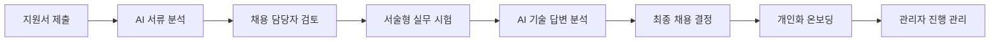
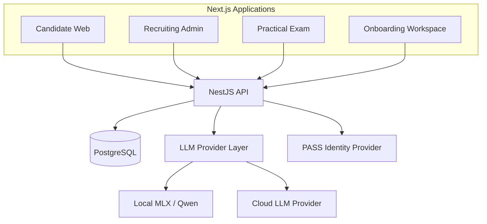
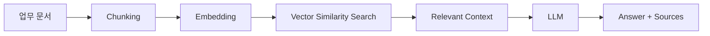

# Relay

> **AI로 지원자의 서류와 기술 답변을 구조화하고, 채용 데이터를 개인화 온보딩까지 연결하는 Full-Stack HR Platform**

`Next.js` · `NestJS` · `TypeScript` · `PostgreSQL` · `TypeORM` · `LLM` · `RAG`

---

## 🎥 Product Demo

[](https://youtu.be/HWngfGtGJwo?si=4Hqi7tjlbHi8GBEP)

### ▶️ [Relay 전체 시연 영상 보기](https://youtu.be/HWngfGtGJwo?si=4Hqi7tjlbHi8GBEP)

> **Portfolio Repository**
>
> 이 저장소는 Relay의 제품 구조, AI 파이프라인, 시스템 설계 및 기술적 의사결정을 소개하기 위한 포트폴리오 저장소입니다.  
> 실제 애플리케이션 소스 코드는 비공개 저장소에서 관리하고 있습니다.

---

## Overview

Relay는 산업용 Vision AI 기업 **Surplus(흑자)**의 채용 운영을 모델로 설계한 MVP입니다.

지원서 접수부터 AI 기반 서류 분석, 서술형 실무 시험, 채용 담당자의 최종 판단, 그리고 합격자의 개인화 온보딩까지 하나의 데이터 흐름으로 연결했습니다.

이 프로젝트에서 집중한 질문은 하나였습니다.

> **채용 과정에서 발견한 지원자의 강점과 부족한 역량을 입사 후 성장 데이터로 이어갈 수 있을까?**

Relay는 AI가 채용 결정을 대신하는 시스템이 아니라, **채용 담당자의 판단을 보조하고 채용 과정에서 생성된 데이터를 이후 온보딩에 재사용하는 시스템**을 목표로 합니다.

---

# Problem

소규모 기술 기업의 채용과 온보딩에서는 다음과 같은 문제가 발생할 수 있습니다.

- 지원자 정보를 Notion이나 Spreadsheet 등으로 다시 옮겨야 합니다.
- 관리자가 모든 이력서를 처음부터 끝까지 검토해야 합니다.
- 단순 정답형 시험만으로는 지원자의 사고 과정과 이해도를 판단하기 어렵습니다.
- 채용 과정에서 확인한 역량 정보가 입사 후 활용되지 않습니다.
- 별도의 교육 담당자가 없는 경우 사수에게 반복적인 온보딩 업무가 집중됩니다.

---

# Solution

Relay는 **각 채용 단계에서 생성된 데이터를 다음 단계의 입력으로 사용**합니다.



핵심은 채용과 온보딩을 서로 분리된 프로세스로 보는 것이 아니라,

**Recruiting → Evaluation → Hiring → Onboarding**

으로 이어지는 하나의 데이터 파이프라인으로 설계하는 것입니다.

---

## 1. 지원 정보 구조화

지원자는 웹에서 직접 지원서를 작성하고 제출합니다.

지원자, 지원서, 채용 공고, 전형 상태 등의 정보를 PostgreSQL에서 일관된 구조로 관리하도록 설계했습니다.

이를 통해 관리자가 지원자 정보를 다른 서비스로 반복해서 옮기는 과정을 줄입니다.

---

## 2. AI 서류 분석

LLM이 지원서와 채용 공고를 함께 분석하여 구조화된 결과를 생성합니다.

분석 항목은 다음과 같습니다.

- 지원자 요약
- 확인된 역량
- 부족하거나 추가 검증이 필요한 역량
- 직무 관련 강점
- 면접에서 추가로 확인할 항목

AI 결과는 자유 형식 텍스트가 아니라 **정의된 JSON 구조**로 생성하여 서버와 관리자 UI에서 안정적으로 사용할 수 있도록 설계했습니다.

> Relay의 AI는 합격자를 자동으로 결정하지 않습니다.

최종 판단은 항상 사람이 수행하며, AI는 판단에 필요한 정보를 구조화해 제공하는 **Human-in-the-loop** 방식을 사용합니다.

---

## 3. 서술형 실무 시험 & AI 분석

지원자는 직무와 관련된 서술형 문제를 풉니다.

Relay는 단순 점수보다 다음과 같은 정보를 분석하는 데 초점을 맞췄습니다.

- 과목별 이해도
- 답변의 논리와 근거
- 지원자의 강점
- 부족한 개념
- 추가 확인이 필요한 영역

MVP에서는 답안과 문항별 체류 시간을 저장하고 분석합니다.

향후에는 시험 과정에서의 AI 대화, 답안 수정 과정 등도 함께 분석하여 **지원자의 문제 해결 과정 자체를 평가 데이터로 활용하는 구조**를 확장할 수 있도록 설계했습니다.

---

## 4. 채용 데이터 기반 개인화 온보딩

Relay의 핵심 차별점은 채용이 끝난 이후입니다.

최종 합격자의 경우 채용 과정에서 확인한:

- 강점
- 부족한 역량
- 기술 평가 결과
- 직무 정보

를 온보딩 시스템으로 전달합니다.

신입사원은 다음 기능을 이용합니다.

- 역할별 온보딩 플랜
- 일일 미션
- 확인 질문
- AI 피드백
- 업무 문서 기반 RAG 챗봇
- 학습 내용 복기

관리자는 구성원별 온보딩 진행률과 결과를 확인할 수 있습니다.

---

# Product Flow

| 사용자 | 주요 경험 |
|---|---|
| 지원자 | 회사 탐색 → 본인인증 → 지원서 제출 |
| 채용 관리자 | 지원자 조회 → AI 서류 분석 → 1차 판단 |
| 시험 응시자 | 시험 안내 → 서술형 실무 문제 → 답안 제출 |
| 채용 관리자 | 답안 및 AI 분석 검토 → 최종 채용 결정 |
| 신입사원 | 문서 기반 AI 질의 → 일일 미션 → AI 피드백 → 복기 |
| 온보딩 관리자 | 역할별 플랜 관리 → 구성원 진행률 및 결과 확인 |

---

# Architecture



프론트엔드는 사용자 역할과 보안 영역에 따라 네 개의 애플리케이션으로 분리했습니다.

### Candidate Web
회사 정보, 채용 공고, 지원서 작성

### Recruiting Admin
지원자 관리, AI 서류 분석, 채용 상태 관리

### Practical Exam
지원자 실무 시험 전용 환경

### Onboarding Workspace
합격자의 개인화 온보딩 환경

백엔드는 하나의 **NestJS API Server**에서 도메인 로직과 AI orchestration, 데이터 접근을 관리합니다.

더 자세한 시스템 구조는 [Architecture](docs/ARCHITECTURE.md)에서 확인할 수 있습니다.

---

# AI Engineering

## Provider Abstraction

Relay의 AI 기능은 특정 모델 제공자에 강하게 종속되지 않도록 설계했습니다.

OpenAI-compatible interface를 기준으로 호출 계층을 구성하여 환경 설정에 따라:

- Local MLX / Qwen
- Cloud LLM Provider

등으로 교체할 수 있도록 했습니다.

---

## Structured Output

LLM의 자유 형식 답변을 그대로 서비스에 사용하는 대신 정의된 JSON Schema 기반 결과를 사용합니다.

이를 통해:

- 관리자 UI 렌더링
- 분석 결과 DB 저장
- 분석 결과 재사용
- 분석 이력 관리

가 가능하도록 설계했습니다.

응답 파싱 또는 검증에 실패하는 경우 잘못된 분석 결과를 DB에 저장하지 않습니다.

---

## RAG Onboarding Assistant

신입사원의 업무 문서를 기반으로 질문에 답변할 수 있는 RAG 챗봇을 설계했습니다.



업무 문서를 일정 단위로 분할하고 임베딩한 후, 질문과 관련성이 높은 문서를 검색하여 LLM Context로 제공합니다.

답변에는 참고한 문서 정보를 함께 제공하도록 설계했습니다.

---

## Human-in-the-loop

Relay는 AI가 사람의 채용 판단을 대신하지 않습니다.

예를 들어 기술 시험 평가 기준의 경우:

```text
AI Draft
   ↓
Recruiter Review
   ↓
Edit
   ↓
Approve
   ↓
Evaluation
```

방식으로 구성했습니다.

AI가 평가 기준의 초안을 생성하더라도 관리자가 검토·수정·승인한 기준만 실제 분석에 사용합니다.

더 자세한 AI 흐름은 [AI Pipeline](docs/AI_PIPELINE.md)에서 확인할 수 있습니다.

---

# Tech Stack

| Layer | Technology |
|---|---|
| Frontend | Next.js App Router, React, TypeScript, Tailwind CSS, Recharts |
| Backend | NestJS, TypeScript, REST API |
| Database | PostgreSQL, TypeORM, SQL Migration, JSONB |
| AI | OpenAI-compatible LLM, Local MLX/Qwen, Embeddings, RAG |
| Authentication | JWT, Admin SSO |
| Security | Argon2, bcrypt, AES-256-GCM |
| External Integration | PASS Identity Provider Boundary |
| Quality | ESLint, TypeScript Type Check, Jest |

---

# What I Built

Relay 프로젝트에서는 전체 제품 흐름과 Full-Stack Architecture를 설계하고 다음 기능들을 구현했습니다.

### Frontend
- 네 개의 역할별 Next.js 애플리케이션
- 반응형 사용자 인터페이스
- 지원자 / 관리자 / 시험 / 온보딩 화면 분리

### Backend
- NestJS 기반 REST API
- Controller–Service–Repository 구조
- 도메인별 NestJS Module 분리
- 지원 상태 전이 관리

### Database
- PostgreSQL 데이터 모델 설계
- TypeORM Entity
- SQL Migration
- JSONB 기반 AI 분석 데이터 저장

### AI
- 지원서 AI 분석
- 기술 시험 답변 분석
- Structured Output 처리
- AI 분석 결과 이력 관리
- Human-in-the-loop 평가 흐름
- 업무 문서 기반 RAG 챗봇

### Onboarding
- 역할별 5일 온보딩 플랜
- 일일 미션
- AI 피드백
- 복기 기능
- 관리자 진행률 관리

### Security
- 지원자 개인정보 암호화
- 관리자 비밀번호 해싱
- JWT Authentication
- 관리자 서비스 간 SSO Bridge

---

# Engineering Highlights

### 1. Domain Separation

지원, 시험, 평가, 온보딩 영역의 책임을 NestJS Module 단위로 분리했습니다.

---

### 2. Database as Source of Truth

지원 상태, AI 분석 결과, 분석 Revision 등의 핵심 상태를 클라이언트가 아닌 서버와 PostgreSQL에서 관리합니다.

---

### 3. Explainable AI Assistance

단순 점수만 보여주는 대신:

- 분석 근거
- 강점
- 부족한 역량
- 추가 검증 항목

을 함께 제공하도록 설계했습니다.

---

### 4. Model Provider Independence

AI 기능을 특정 모델에 종속시키지 않고 Provider Layer를 만들어 로컬 모델과 Cloud LLM을 교체할 수 있도록 설계했습니다.

---

### 5. Role-based Application Separation

지원자, 시험 응시자, 채용 관리자, 신입사원의 UI와 접근 영역을 분리하여 각 사용자의 목적에 맞는 경험을 제공하도록 구성했습니다.

---

# MVP Scope

Relay는 제품 가설과 전체 사용자 흐름을 검증하기 위한 MVP입니다.

현재 범위에는 다음과 같은 제한이 있습니다.

- PASS 연동 지점은 설계했지만 로컬 데모에서는 우회할 수 있습니다.
- 지원서 첨부파일은 현재 메타데이터 중심으로 처리합니다.
- 운영 환경에서는 별도의 Object Storage 연동이 필요합니다.
- 시험 결과는 데모 지원자와 연결되는 MVP Flow를 사용합니다.
- AI는 채용 담당자의 판단을 보조하며 자동 합격·불합격에 사용하지 않습니다.
- 실제 운영 전에는 관리자 API 권한 정책과 Audit Log를 추가로 강화해야 합니다.

---

# Documentation

- [Architecture](docs/ARCHITECTURE.md)  
  시스템 경계, 모듈 구조 및 데이터 흐름

- [AI Pipeline](docs/AI_PIPELINE.md)  
  지원서 분석, 기술 평가, RAG 및 AI 안전장치

- [Demo Scenario](docs/DEMO_SCENARIO.md)  
  Relay 제품 데모 흐름

- [Engineering Notes](docs/ENGINEERING_NOTES.md)  
  기술 선택, 트레이드오프 및 향후 개선 방향

---

# Closing

좋은 채용은 좋은 사람을 뽑는 것으로 끝나지 않습니다.

채용 과정에서 확인한 지원자의 가능성과 부족한 역량이 실제 업무 역량으로 이어질 수 있어야 합니다.

**Relay는 지원, 평가, 채용, 온보딩 사이의 데이터를 다음 성장 단계로 전달합니다.**

---

### 🎥 [Relay Product Demo on YouTube](https://youtu.be/HWngfGtGJwo?si=4Hqi7tjlbHi8GBEP)
