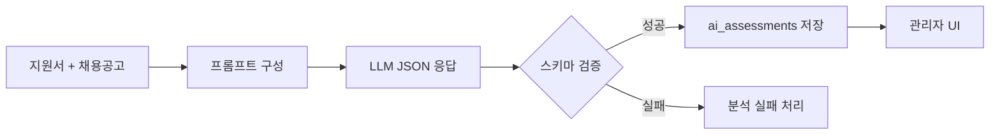
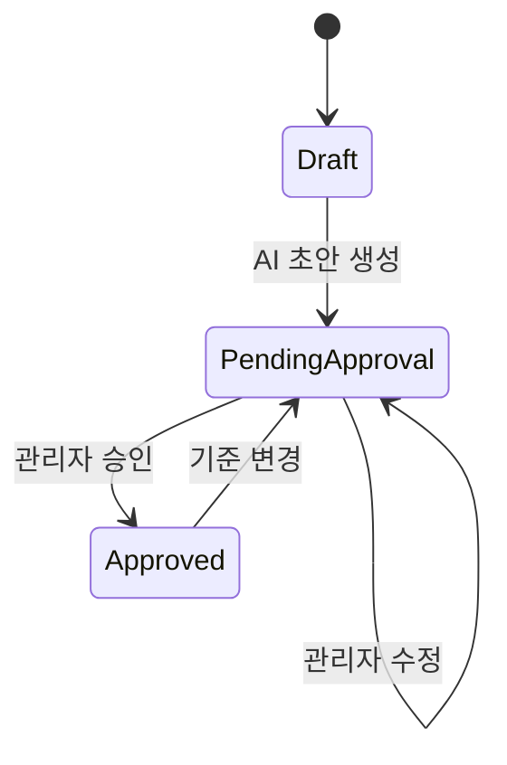
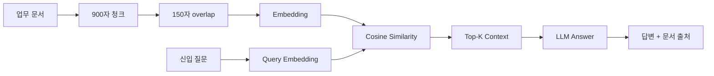

# AI Pipeline

## 1. Design Goal

Relay에서 AI는 사람 대신 채용 결정을 내리지 않습니다. 많은 원문을 빠르게 구조화하고, 사람이 확인해야 할 근거와 질문을 만드는 역할을 담당합니다.

핵심 원칙은 다음과 같습니다.

1. 입력으로 제공된 자료 밖의 사실을 추측하지 않습니다.
2. 자유 텍스트가 아니라 검증 가능한 JSON 구조로 응답합니다.
3. AI 결과와 원문을 관리자가 함께 확인합니다.
4. 채점 기준은 사람의 승인을 거칩니다.
5. 같은 입력의 분석 이력을 리비전으로 보존합니다.

## 2. Resume Analysis

### Input

- 지원 직무와 직무 설명
- 필수·우대 역량
- 경력, 학력, 기술 스택
- 프로젝트와 자기소개
- 포트폴리오 URL

### Structured output

```json
{
  "summary": "지원자 요약",
  "confirmedSkills": ["근거가 확인된 역량"],
  "missingSkills": ["지원서에서 확인되지 않은 직무 역량"],
  "strengths": ["직무 관련 강점"],
  "needVerification": ["면접에서 확인할 항목"]
}
```

### Processing



입력 프롬프트의 SHA-256 해시를 함께 저장해 어떤 입력 스냅샷으로 분석했는지 추적할 수 있습니다.

## 3. Technical Test Analysis

기술시험 분석은 질문, 지원자의 답변, 평가 기준을 한 묶음으로 처리합니다.

```json
{
  "evaluations": [
    {
      "category": "cad",
      "level": "good",
      "comment": "평가 근거"
    }
  ],
  "strengths": ["시험에서 확인된 강점"],
  "needVerification": ["추가 확인이 필요한 내용"]
}
```

`level`은 `good`, `fair`, `needs_verification`으로 제한합니다. 관리자 화면에서는 과목별 답변과 평가 근거를 함께 보여줍니다.

### What can be reviewed?

- 질문 의도를 이해했는지
- 답변이 평가 기준의 핵심 요소를 포함하는지
- 기술적 결론에 근거가 있는지
- 답변 간 논리가 일관되는지
- 이력서에서 주장한 역량과 시험 답변이 일치하는지
- 추가 면접에서 확인해야 할 위험 요소가 무엇인지

## 4. Human-approved Criteria

문제은행의 평가 기준은 다음 상태를 가집니다.



승인된 기준만 기술시험 분석에 우선 적용합니다. 이를 통해 생성형 AI가 만든 기준이 검토 없이 실제 평가에 사용되는 것을 방지합니다.

## 5. Onboarding RAG

업무 문서 기반 챗봇은 다음 순서로 답변합니다.



임베딩 API가 없는 로컬 환경에서는 문서 전체를 컨텍스트로 사용하는 폴백을 제공해 MVP 시연이 중단되지 않도록 했습니다. 운영 환경에서는 토큰 비용과 검색 정확도를 위해 임베딩 기반 검색을 사용합니다.

## 6. Personalized Onboarding

AI는 역할별 업무 문서를 바탕으로 5일 플랜과 확인 질문을 만듭니다.

- 미션 학습 내용 제공
- 확인 질문 생성
- 신입사원 답변 평가
- 통과 여부와 피드백 제공
- 일별 복기를 다음 학습 계획에 반영
- 전체 과정 완료 후 요약 리포트 생성

채용 분석 결과를 온보딩 입력으로 자동 변환하는 부분은 다음 단계의 핵심 확장 범위입니다. 현재 MVP는 같은 데이터베이스와 관리자 경험을 통해 두 흐름의 연결 가능성을 보여줍니다.

## 7. Provider Strategy

```text
Application Service
       │
       ▼
OpenAI-compatible interface
       ├── Local MLX / Qwen
       └── Cloud LLM
```

모델별 SDK를 비즈니스 서비스에 직접 결합하지 않고 환경변수로 제공자를 선택합니다. 로컬 모델은 개인정보가 포함된 입력을 외부로 보내지 않는 시나리오에 적합하고, 외부 모델은 높은 분석 정확도가 필요한 작업에 선택적으로 사용할 수 있습니다.

## 8. Failure Handling

- AI 서버 연결에 30초 제한 시간을 둡니다.
- 통신 실패와 형식 오류를 사용자 메시지로 변환합니다.
- JSON 코드펜스를 제거한 뒤 파싱해 소형 로컬 모델의 응답 편차를 처리합니다.
- 필수 필드가 없으면 DB에 결과를 저장하지 않습니다.
- 재분석은 기존 결과를 덮지 않고 새 리비전으로 관리합니다.

## 9. Evaluation Plan

운영 수준으로 발전시키기 위해 다음 평가셋이 필요합니다.

| Area | Metric |
|---|---|
| Resume extraction | 필드별 precision / recall |
| Skill matching | 채용 담당자와 AI의 일치율 |
| Technical scoring | 전문가 평가와 AI 평가의 상관관계 |
| RAG retrieval | Recall@K, 인용 근거 포함률 |
| Answer quality | 정확성, 근거성, 환각률 |
| Operations | 응답 시간, 실패율, 분석당 비용 |

AI의 정확도는 모델 이름보다 평가 데이터와 승인 기준으로 관리한다는 원칙을 적용했습니다.

