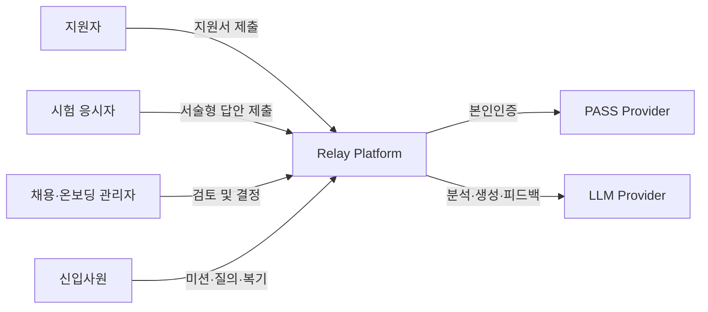
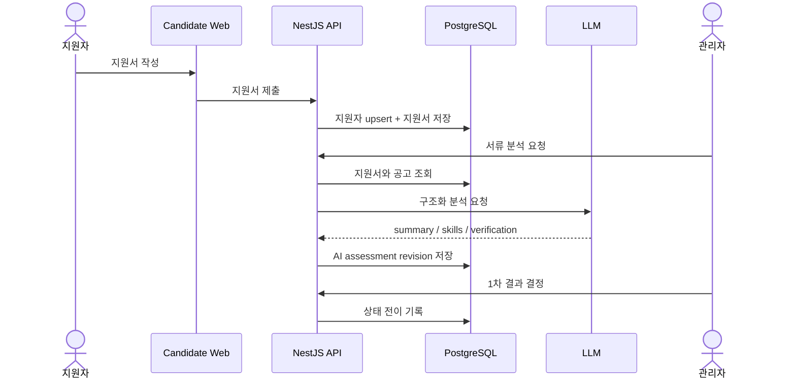
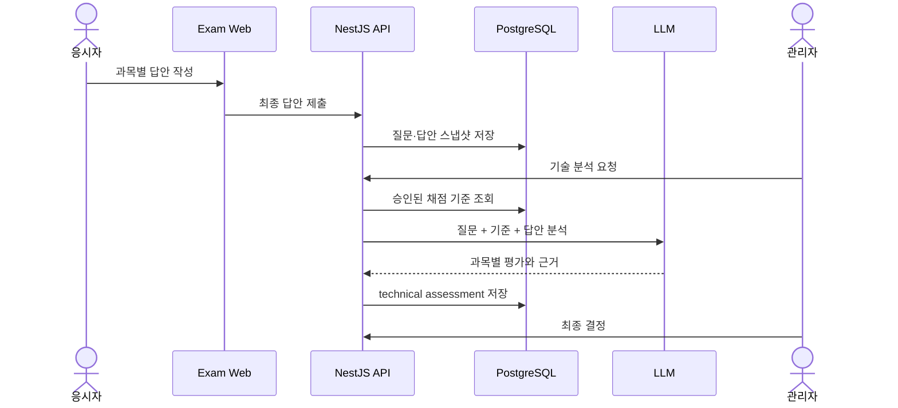
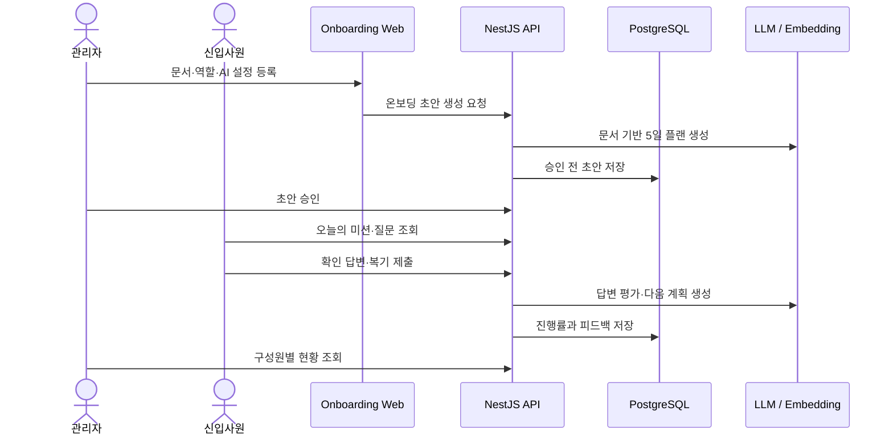

# Architecture

## 1. System Context

Relay는 사용자 목적과 운영 정책이 다른 네 개의 웹 애플리케이션을 하나의 API와 데이터베이스에 연결합니다.



## 2. Runtime Components

| Component | Port | Responsibility |
|---|---:|---|
| Candidate Web | 3000 | 기업·제품 소개, 채용 공고, 지원서 제출 |
| Recruiting Admin | 3001 | 지원자 검토, AI 분석, 시험 결과, 채용 결정 |
| Practical Exam | 3002 | 본인인증, 과목 안내, 서술형 시험 제출 |
| Onboarding Workspace | 3004 | 신입 AI 챗봇·미션, 관리자 온보딩 운영 |
| API Server | 4000 | 인증, 비즈니스 규칙, AI 오케스트레이션, DB 접근 |
| PostgreSQL | 5432 | 채용·시험·AI 분석·온보딩 데이터 |
| LLM Server | 8080 by default | 로컬 MLX 또는 외부 OpenAI 호환 추론 |

## 3. Backend Module Boundaries

```text
src/
├── modules/
│   ├── auth/                    # 채용 관리자 인증·세션·MFA 경계
│   ├── candidates/              # 지원자 식별정보와 암호화 저장
│   ├── applications/            # 지원서·상태 전이·AI 분석
│   ├── identity-verification/   # PASS 인증 경계
│   ├── question-bank/           # 기술문제와 채점기준 승인
│   ├── exam-*/                  # 예약·기기·세션·답안
│   ├── ai-interaction/          # 시험 중 AI 상호작용 확장 경계
│   ├── evaluation/              # 평가 결과
│   ├── inquiries/               # 기업 문의
│   └── audit/                   # 운영 감사 경계
└── relay-onboarding/
    ├── auth/                    # JWT·채용 관리자 SSO
    ├── workspaces/              # 조직·멤버·역할
    ├── workspace-content/       # 문서·지식·체크리스트·AI 설정
    ├── onboarding/              # 역할별 플랜·미션·복기·리포트
    ├── chat/                    # 문서 기반 AI 대화
    └── admin/                   # 전체 사용자·워크스페이스 관리
```

서비스가 길어지는 도메인은 Repository를 분리해 데이터 접근과 비즈니스 규칙을 구분했습니다. 원시 SQL이 필요한 복합 조회는 Repository에 캡슐화하고, Service는 사용자 흐름을 조합합니다.

## 4. Recruitment Data Flow



## 5. Exam Data Flow



질문과 평가 기준은 응시 시점의 스냅샷을 보존합니다. 문제은행에서 승인된 최신 기준이 있으면 분석에 사용하되, 제출 당시 원문은 변경하지 않습니다.

## 6. Onboarding Data Flow



## 7. Core Data Groups

| Domain | Main tables |
|---|---|
| Identity | `users`, `candidates`, `identity_verifications` |
| Recruitment | `positions`, `applications`, `application_status_history` |
| Exam | `exam_appointments`, `exam_devices`, `exam_sessions`, `exam_questions`, `exam_answers` |
| AI & Evaluation | `ai_interactions`, `ai_assessments`, `evaluations` |
| Onboarding | `onboarding_users`, `onboarding_workspaces`, `onboarding_role_groups`, `onboarding_plans`, `onboarding_days`, `onboarding_missions` |
| Knowledge & Chat | `onboarding_documents`, document chunks, knowledge items, chat sessions and messages |

## 8. Security Boundaries

- 지원자 개인정보는 AES-256-GCM으로 암호화하고 화면에 필요한 시점에만 복호화합니다.
- 채용 관리자 비밀번호는 Argon2id, 온보딩 계정 비밀번호는 bcrypt로 해싱합니다.
- 채용 관리자 세션을 검증해 온보딩 SUPERADMIN 토큰으로 교환하는 SSO 브리지를 사용합니다.
- AI 호출에는 필요한 지원서·답안·문서 범위만 전달하도록 서비스 경계를 분리했습니다.
- 실제 비밀키와 지원자 파일은 Git에서 제외합니다.

## 9. Why Four Frontends?

하나의 UI에 모든 기능을 넣는 대신 사용 맥락을 기준으로 분리했습니다.

- 공개 채용 사이트는 검색 노출과 지원 전환에 집중합니다.
- 관리자 화면은 고밀도 정보 검토와 의사결정에 집중합니다.
- 시험 화면은 제한 시간, 제출 확인, 응시 흐름에 집중합니다.
- 온보딩 화면은 장기간 반복 사용과 역할 기반 경험에 집중합니다.

모든 앱이 같은 API를 사용하므로 데이터 규칙은 프론트엔드가 아니라 서버에 유지됩니다.
